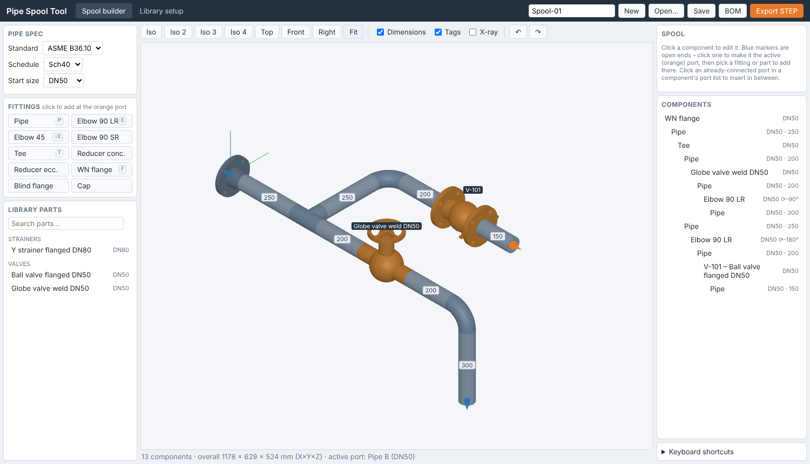

# Pipe Spool Tool

Build pipe spools in an isometric 3D view from the parts in your
[Part-Library](https://github.com/Ryan1234abcd/Part-Library), set the centre-to-centre dimensions, and
save the whole spool as **one STEP file**, shrink-wrapped so it stays small. For a Revit family,
the pipes and fittings can instead be built natively by a Dynamo graph, with pipe connectors and
references at the ends, and only the valves come as a STEP.

**It runs entirely in your web browser. There is nothing to install.**



## Start

1. Open **`pipe-spool-tool.html`** (double-click it). Chrome or Edge is recommended.
2. The first time, the page downloads the 23 MB OpenCascade CAD engine from a public CDN
   (jsDelivr, with unpkg as a fallback). The browser caches it after that.
3. Click **Open Part-Library…** and choose your copy of the Part-Library folder (the one with
   `library.json`, `geometry.json` and `models/`). In Chrome/Edge the page remembers it; next time
   click **Reconnect**.

A few 50NB / 40NB Sch 10S parts, a butterfly valve and a wafer check valve are built in, so you can
try it before opening the library.

## Build a spool

1. **Pick the pipe type, start and first part.** Choose the pipe type (e.g. Sch 10S pipe or dairy
   tube) – the start size list then only has that type's sizes – and whether the spool starts
   horizontal or vertical (**Start**; it can be changed later on the first part), then click a part.
2. **Carry on from the orange end.** The list only shows parts that fit that end: the same pipe size
   and a connection that mates with it. Weld ends and BSP female ends are joined with a pipe (marked
   **+ pipe**); BSP male into female, RJT, and flange to flange or wafer valve go straight together
   (flanges match by their drilling). Click any blue marker to carry on from another open end.
   The chips above the list pick one part type at a time (Elbows & bends, Tees, Valves…, or All).
   Flanged joints match by size only (DN), whatever the flange standard.
   **Valves on a welded line** (Sch 10S pipe, dairy tube) are listed too, marked **+ weld nipple**
   or **+ flange**. Their ends are BSP or flanged, so clicking one adds that adaptor first (a weld
   nipple for BSP valves, a flange for wafer and lugged valves), then the valve on it.
3. **Rotate and connect.** Select a part and roll it with **⟳ 90°** / **⟲ 90°** (`R` / `Shift+R`) or
   type an angle. **Connected by** picks which end it is joined by (a tee's run end or its branch);
   **Next part on** picks which free end the next part goes on.
4. **Dimension.** Click a pipe, or its dimension in the view, and type the **centre-to-centre**
   (fitting centre to fitting centre; to the pipe end when nothing is beyond it). The pipe's cut
   length is worked out from each fitting's centre-to-end. You can switch a pipe to a plain
   **cut length**, or make it **close-coupled** (no pipe, fittings welded straight together).
5. **More runs.** **+ Start point** (`S`) starts another run at **X / Y / Z** (mm) from the spool
   origin (where the first part starts), with its own direction and size. Add parts or a pipe
   (`P`) on its orange end and build from there; change the coordinates any time.
6. **Branches.** Select a pipe and click **Branch…**, then pick a weld nipple (normal or extended),
   a tube weld nipple or a half socket: it is stabbed into the pipe (set in, flush with the bore).
   Set **Along pipe** (from the upstream fitting centre) and **Round pipe** (angle), then carry on
   from the nipple's thread.
7. **Valve handles.** Ball valves and lever butterfly valves have **Handle: Open / Closed**; closed
   turns the lever (and the ball) a quarter turn about the stem, in the view and the export.

8. **Edit the line.** In the **Spool** list each part has **↑ ↓ ×** (on hover, or on the selected
   row):
   - **↑ / ↓** swap a fitting with the one before or after it in its line (two-ended fittings; the
     pipes between keep their dimensions). A swap whose ends wouldn't fit is refused.
   - **×** (or `Del`) removes just that part or pipe and closes the gap. Pipes either side of a
     removed valve merge into one, a pipe grows to reach the next part, or the next part joins
     straight on. What is beyond stays where it is; if it can't join up (after an elbow, say), it
     becomes its own run, still in place. Removing the first fitting keeps the rest.
     **Delete with everything beyond** (`Shift+Del`) is the old delete.
   - **Insert part…** on a pipe puts a part in its middle. A valve on a welded line gets a weld
     nipple or flange either side. **Insert after…** on a fitting puts one between it and the
     next. The pipe is split or shortened so what is beyond doesn't move.
   - **+ pipe on end n** (in a part's panel) puts a straight pipe on an open end, including the
     first part's start end. Or click any blue marker and press `P`.
9. **Align.** Select a part or pipe, click **Align…**, then click the part or pipe to line it up
   with. Choose which points (centre, an end face, a pipe end), and **same X**, **same Y** or
   **same RL (Z)**. The nearest pipe behind it that runs along that axis changes length to suit.
   Tick **Keep lined up** to lock it: the pipe then follows whenever anything else changes (🔒 in
   the list; **Unlock** in the panel).

**RJT unions** are one part: an RJT female half and an RJT male half of the same size come screwed
together (e.g. *RJT Union BSP male × BSP male*), and only their outer ends connect. The BOM lists
both halves.

Fitting centres: where the centrelines cross (elbows, tees), midway between the ends (valves,
reducers), the flange face (flanges) or the end (caps). A pipe screwed into a BSP female end goes in
by the thread engagement, and the cut length allows for it.

**Save** / **Open** keep spools in this browser; the open dialog also imports and downloads `.json`.
The current spool is kept automatically. **BOM** gives a parts list and pipe cut list (CSV).

| Key | |
|---|---|
| `F` or `/` | search parts, Enter adds the first match |
| `R` / `Shift+R` | roll the selected part ±90° |
| `X` | turn the selected part round |
| `P` | plain pipe on the orange end |
| `N` | next open end |
| `Del` | remove the selected item and close the gap |
| `Shift+Del` | delete the selected item and everything beyond it |
| `Esc` | cancel insert / branch / align, or clear the selection |
| `Ctrl+Z` / `Ctrl+Y` | undo / redo |

## Export

**Export** gives two outputs:

- **One STEP file**: the whole spool, merged into one solid per line. It is the right choice for
  anything other than a Revit family.
- **Revit family**: the pipes and simple fittings (elbows, tees, reducers, flanges, caps, nipples,
  unions) are written as simple shapes that the Dynamo graph builds as **native Revit solids**.
  Only the valves and strainers go in a (smaller) STEP file. See [Into a Revit family](#into-a-revit-family).

Native fittings have clean outlines at the pipe OD: no cast lettering, no seams. For the STEP,
choose the level of detail:

| Level | What you get | Typical size |
|---|---|---|
| **Envelope** | each part replaced by a smooth outline (spun round its pipe line, rings for bends) and a block for each handle or bonnet | smallest |
| **Shrink-wrap** | the part's real outside: hidden inner parts (balls, seats, springs) left out, bores and threads filled, bolt holes and other holes and loose bits smaller than the **resolution** removed | small |
| **Full model** | the original manufacturer geometry | largest |

**Build preview** shows the result, its face count and file size before you download it.
- Pipes are solid unless you tick **Hollow pipes** on the full model.
- All levels are written without the duplicate 2D edge curves and with numbers to 0.001 mm,
  which roughly halves the file.
- Complex valves take a few seconds each to shrink-wrap the first time.

## Into a Revit family

Revit only hosts pipe connectors on its own family geometry, never on imported geometry (STEP,
or DWG that hasn't been exploded). A browser can't write DWG solids, so instead the tool hands
the simple parts to a Dynamo graph, which builds them natively in the family.

1. **Export → Revit family.** You get `<spool>-valves.stp` (when there are valves) and
   `<spool>-revit.json`.
2. In the family editor, **Insert → Import CAD**, pick the valve STEP, **Positioning: Auto –
   Origin to origin**, units millimetres.
3. **Manage → Dynamo**, open [`revit/Spool family.dyn`](revit/Spool%20family.dyn), pick the
   `-revit.json`, set the pipe system (e.g. `OtherPipe`, `SupplyHydronic`), choose whether the
   connector diameter is the nominal size (DN) or the pipe OD, and **Run** (once per family;
   Ctrl+Z undoes a run).

The graph:
- builds every pipe and fitting as native revolves and extrusions;
- puts a sized **pipe connector** on the end face of each open end, straight on the native
  fitting or pipe (on a valve end, on a thin hidden disc, as Revit needs);
- adds a **reference line on the pipe centreline** and a **reference plane on the end face**
  (named `E1 end`, `E2 end`…) at each open end, to align the family with adjacent pipes.

The **Result** node lists what it made and any end it couldn't do. Check that the connector
arrows point out of the spool.

The **One STEP file** export can also save the `.json` (tick **Revit file**). The graph then only
adds the connectors and references to an imported spool.

The script is also in [`revit/spool_family.py`](revit/spool_family.py), to paste into a Python node
(CPython3) or pyRevit; `node scripts/make-dyn.mjs` rebuilds the graph from it.
`tests/revit_stub.py` runs it against a stand-in for the Revit API (part of `npm test`).

## Develop

```bash
npm install          # three.js and the OpenCascade WebAssembly build
npm run build        # web/ -> pipe-spool-tool.html (commit it)
npm test             # node tests using the same CAD engine
```

| Path | Contents |
| --- | --- |
| `web/js/app.js` | spool builder UI |
| `web/js/joints.js` | which ends fit together, pipe sizes, cut length from dimensions |
| `web/js/kinematics.js` | end-to-end placement |
| `web/js/edit.js` | remove and close the gap, move up/down, insert, align |
| `web/js/wrap.js` | shrink-wrap: simple solids that enclose a part; native Revit shapes for fittings |
| `web/js/library.js` | reads Part-Library (`library.json` + `geometry.json`) |
| `web/js/revit.js`, `revit/` | Revit file; Dynamo graph and script that build the family (native fittings, connectors, references) |
| `web/js/cad.js`, `cad-worker.js`, `cad-client.js` | OpenCascade (WebAssembly) in a Web Worker |
| `scripts/library-geometry.mjs`, `scripts/ends.mjs` | find each part's ends in its STEP model → Part-Library `geometry.json` |
| `scripts/make-demo.mjs` | copy the built-in demo parts from Part-Library into `library/Demo/` |

After adding parts to Part-Library, run `node scripts/library-geometry.mjs ../Part-Library <ids…>`
and commit the updated `geometry.json` there.

`node scripts/build.mjs --hosted DIR` also writes a copy for a web server, with the CAD kernel split
into `DIR/oc/` so it loads from the same site instead of the CDN.

**Licences:** three.js (MIT); OpenCascade via
[replicad-opencascadejs](https://www.npmjs.com/package/replicad-opencascadejs) (LGPL-2.1, loaded
unmodified at runtime).
